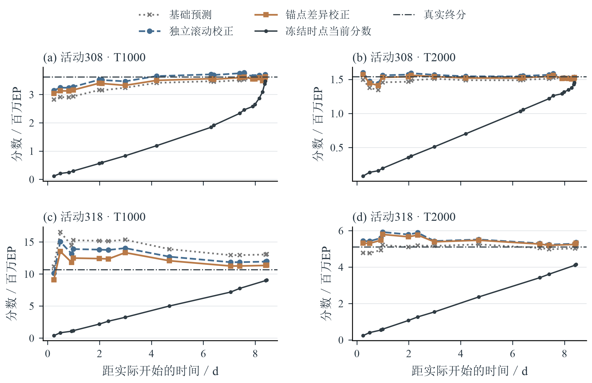

# BanG Dream! 活动分数线预测

使用国服历史活动曲线预测T10至T30000共19条排名线的终分。当前生产入口使用已训练的CatBoost模型与在线误差校正。后续实验使用下面的密集采样时期数据，原版实验继续留档。

<!-- research-overview:start -->
## 研究论文与 PDF

作者均为 **Tano**。对外 PDF 使用完整论文标题命名，三篇正文与独立补充材料均保存在本仓库的 `papers/published/`。

| 稿件 | PDF | 页数 |
|---|---|---:|
| 原始预测研究稿 | [非平稳音乐游戏活动排名终分预测的时间一致评测与结构化在线误差校正](papers/published/%E9%9D%9E%E5%B9%B3%E7%A8%B3%E9%9F%B3%E4%B9%90%E6%B8%B8%E6%88%8F%E6%B4%BB%E5%8A%A8%E6%8E%92%E5%90%8D%E7%BB%88%E5%88%86%E9%A2%84%E6%B5%8B%E7%9A%84%E6%97%B6%E9%97%B4%E4%B8%80%E8%87%B4%E8%AF%84%E6%B5%8B%E4%B8%8E%E7%BB%93%E6%9E%84%E5%8C%96%E5%9C%A8%E7%BA%BF%E8%AF%AF%E5%B7%AE%E6%A0%A1%E6%AD%A3.pdf) | 16 |
| 第二轮预测研究稿 | [音乐游戏活动终分预测：延迟反馈下的跨排名共享与失效诊断](papers/published/%E9%9F%B3%E4%B9%90%E6%B8%B8%E6%88%8F%E6%B4%BB%E5%8A%A8%E7%BB%88%E5%88%86%E9%A2%84%E6%B5%8B%EF%BC%9A%E5%BB%B6%E8%BF%9F%E5%8F%8D%E9%A6%88%E4%B8%8B%E7%9A%84%E8%B7%A8%E6%8E%92%E5%90%8D%E5%85%B1%E4%BA%AB%E4%B8%8E%E5%A4%B1%E6%95%88%E8%AF%8A%E6%96%AD.pdf) | 45 |
| 游戏数据分析稿 | [BanG Dream国服活动排名分数的时序结构与活动条件关联](papers/published/BanG%20Dream%E5%9B%BD%E6%9C%8D%E6%B4%BB%E5%8A%A8%E6%8E%92%E5%90%8D%E5%88%86%E6%95%B0%E7%9A%84%E6%97%B6%E5%BA%8F%E7%BB%93%E6%9E%84%E4%B8%8E%E6%B4%BB%E5%8A%A8%E6%9D%A1%E4%BB%B6%E5%85%B3%E8%81%94.pdf) | 15 |
| 第二轮补充材料 | [补充材料：音乐游戏活动终分预测](papers/published/%E8%A1%A5%E5%85%85%E6%9D%90%E6%96%99%EF%BC%9A%E9%9F%B3%E4%B9%90%E6%B8%B8%E6%88%8F%E6%B4%BB%E5%8A%A8%E7%BB%88%E5%88%86%E9%A2%84%E6%B5%8B.pdf) | 19 |

原始稿与第二轮稿记录同一预测项目的不同研究阶段；游戏数据分析稿描述活动分数、排名关系及活动条件的统计关联。论文仅提供 PDF；LaTeX、参考文献库和编译素材保存在本地。页数见上表，下面的校验命令会输出标题、作者和 SHA-256。

在保有论文原稿的本地工作区，可同步已有编译结果；普通检出仓库可直接执行第二条命令校验阅读版：

```bash
uv run --locked python deploy/paper_assets.py sync
uv run --locked python deploy/paper_assets.py verify papers/published
```

## 模型预测能力与实验结论

下表使用同一 **19 条排名线、16 期测试活动、5,220 个去重预测前缀**的 V3 历史面板。研究队列共97期，按实际开始时间划分为67期训练、14期验证、16期测试。V3在每期开始时固定历史池，先前活动结束后允许反馈其终分。主指标为活动等权 MAPE（%，越低越好），先计算每期活动的平均相对误差，再对活动平均。

**证据范围：测试队列已参与历史探索，验证集曾反复使用，元数据为回溯快照。以下成绩属于历史探索性证据；当前重新拟合权重的未来表现须通过前瞻预测记录检验。**

| 方法 | 验证 MAPE | 测试 MAPE | 在研究中的身份 |
|---|---:|---:|---|
| CatBoost 基础预测 | 6.672 | 7.082 | 固定基础控制 |
| 独立暖启动 EWMA | 6.502 | 6.671 | 本轮验证选定的主参考 |
| 双线组合＋其余线独立校正 | 6.556 | 6.540 | 默认部署配方；历史探索后采用 |
| 共享编码＋共享输出 | 6.617 | 6.716 | 结构探索对照 |
| 共享编码＋排名专属头 | 6.917 | 7.240 | 结构探索对照 |
| 专属头＋相关线信息 | 6.877 | 7.213 | 结构探索对照 |
| 相关线＋阶段图与门控 | 6.813 | 7.218 | 结构探索对照 |

在这个面板上，独立校正相对基础预测下降 **0.411 个百分点**；默认部署组合相对基础预测下降 **0.541 个百分点**，相对降幅 **7.65%**。双线组合相对独立校正下降 **0.130 个百分点**。第二轮固定消融中，仅保留差异项的回放 MAPE 为6.511%，完整组合额外锚点收益的配对区间跨零，后续验证仍需检验共享结构的价值。

默认部署组合的案例相对误差中位数为 **3.305%**，P90为 **16.559%**。其总体 RMSE 高于未校正基础预测，说明平均相对误差改善与大分数异常误差存在权衡。

线上每期使用期初固定的权重和校正快照，实际生效策略以该活动的绑定记录为准；默认配方更新在下一期生效。

### 不同分数线与预测阶段

| 排名 | 测试活动数 | 基础预测 MAPE | 独立校正 MAPE | 默认部署组合 MAPE |
|---|---:|---:|---:|---:|
| T1000 | 16 | 19.072 | 10.797 | 8.543 |
| T2000 | 16 | 4.966 | 4.687 | 4.545 |

| 预测时点 | 默认部署组合 MAPE | 活动数 | 前缀数 |
|---|---:|---:|---:|
| 活动进度25% | 10.403 | 15 | 279 |
| 活动进度50% | 7.962 | 16 | 299 |
| 活动进度75% | 5.858 | 16 | 299 |
| 结束前24小时 | 3.918 | 16 | 299 |
| 结束前6小时 | 2.283 | 14 | 263 |

各时点的有效活动和排名覆盖存在差异；表格用于分层展示。同一前缀可同时属于进度轴和剩余时间轴，总体评分按唯一案例去重。完整19线结果、指标解释和来源见 [模型预测能力与证据](docs/research/model-capability.md)。

### 已封存预测案例



图中活动按实际开始时间排序，固定选取测试队列第1和第8期，即308、318期，选择规则与误差无关。各点为已封存的预测时刻，折线连接这些时点。318期T1000持续高估终分，保留了模型的失败情形。对应 [案例数据](docs/research/evidence/activity_forecast_examples.csv) 与 [选择规则](docs/research/evidence/activity_forecast_selection.json)。

实验支持的主要结论：

1. 历史误差校正在该面板上降低了平均相对误差。
2. T1000与T2000的难度差异明显，预测阶段也影响误差，整体均值需要结合分线、分阶段结果阅读。
3. 跨排名终分关联很强，剩余增长、预测误差及跨期持续性呈现不同结构。共享策略需要以可迁移的历史误差为依据；新增共享头和门控结构在该面板中没有取得稳定优势。
4. 当前部署保留固定树模型和既定校正规则，后续权重更新使用新增合格训练数据。新活动的实际成绩与尾部风险将继续记录。

数字取自 [主要方法表](docs/research/evidence/main_models.csv)、[19线结果表](docs/research/evidence/rank_results.csv)、[时间分层结果](docs/research/evidence/stage_results.csv) 及第二轮论文。不同数据队列、排名范围和时间网格的总分分别解释。
<!-- research-overview:end -->

## 安装与启动

统一使用 uv，Python 与依赖版本由 `.python-version`、`pyproject.toml` 和 `uv.lock` 固定。在项目根目录执行：

```bash
uv sync --locked
uv run --locked app.py
```

打开 **http://127.0.0.1:8765**。网页按配置同步观测、调用已有权重、保存预测并更新误差反馈。默认每15分钟串行取数，每15秒读取已保存结果。网页服务不拟合模型。

首次部署需安装已训练的模型包；已有本地模型和账本可以继续使用：

```bash
uv run --locked python -m production.model_release install /path/to/model.tar.gz --root runtime/live
uv run --locked app.py --host 127.0.0.1 --port 8765

# 可选：只预测一条线并退出
uv run --locked forecast.py --rank 1000
```

参数、网页功能和状态文件见 [运行说明](docs/production/running.md)。Linux 与 Docker Compose 部署、镜像构建和模型发布见 [部署说明](docs/production/deployment.md)。

## 项目结构

```text
app.py                    网页入口：只加载已有权重
forecast.py               单条分数线预测入口
production/               数据同步、推理、反馈账本与网页
training/
  train.py                独立训练和评测入口
  cli.py                  命令路由与历史读取
  model_fit.py            固定生产配方的实际拟合
  analysis/               完整研究与评测模块
  legacy/                 旧版脚本及兼容导入
  research_archive/       研究设计、预登记和审计记录
pyproject.toml / uv.lock   统一依赖与锁文件
papers/published/         三篇论文和补充材料，仅 PDF
```

`data/`、旧 `analysis/` 运行目录、`runtime/` 和权重目录是本地数据与工件，按现有忽略规则保留。序列化兼容使用原有 `analysis.*` 导入名，实际源码位于 `training/analysis/`。

## 显式训练

生产 CatBoost 配方的训练只需默认依赖，输出新的不可覆盖模型包，网页模型由安装步骤切换：

```bash
uv run --locked training/train.py fit \
  --database data/db.sqlite3 --metadata data/metadata \
  --before '2026-11-13T13:00:00+08:00' \
  --output training/models/versions
```

`--before` 使用目标活动开始时刻，仅接纳密集采样时期且严格在该时刻前已结束的活动。默认训练19条线，可重复指定 `--rank`。新权重不替代当前活动的期初绑定。

完整训练、固定 V1/V2/V3 实验与独立评分说明见 [training/README.md](training/README.md)。神经网络和其他研究方法按需安装：

```bash
uv sync --locked --group research
uv run --locked --group research training/train.py --help
```

历史研究过程见 [实验记录](training/RESEARCH_HISTORY.md)，固定数据规范见 [AGENTS.md](AGENTS.md)。
